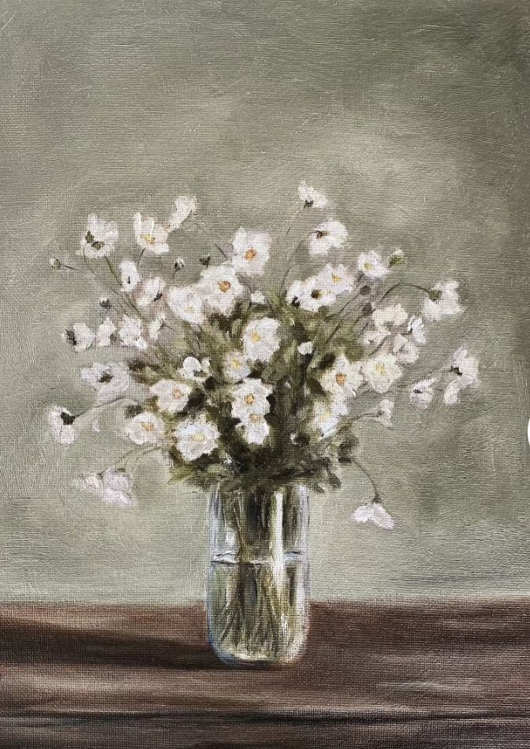

<div align="center">

# ✿ BloonSpace — Login

**A calm, floral login page for an art community where artists and collectors share, discover and collect beautiful work.**




</div>

---

## About

BloonSpace Login is a single-page, responsive sign-in screen built with plain HTML and Tailwind CSS. The design takes its palette from the still-life painting above: soft sage greens, deep forest tones and clean white cards.

## Features

- **Split layout.** The painting sits beside the login card on desktop, and the card stands alone on mobile.
- **Login form.** Username and password fields, "Remember me", and a "forgot password?" link.
- **Social sign-in.** Buttons for Google and Apple.
- **Responsive navbar.** Links to Explore, Artists, Collections and About, plus a Sign up button.
- **Footer.** Link columns and a newsletter sign-up form.
- **No build step.** Tailwind v4 loads from a CDN through `@tailwindcss/browser`.

## Color palette

| Swatch | Name | Value |
| :---: | --- | --- |
|  | Sage (background) | `rgb(185, 190, 180)` |
|  | Forest (footer) | `rgb(52, 60, 50)` |
|  | Green 950 (text) | Tailwind `green-950` |
|  | Slate 500 (button) | Tailwind `slate-500` |

## Getting started

Clone the repo and open the page in your browser:

```bash
git clone https://github.com/dannieexe-dumbah/bloomspace-login.git
cd bloomspace-login
open login.html        # macOS
# or: xdg-open login.html (Linux) / start login.html (Windows)
```

For live reload while you edit, use a local server such as the VS Code **Live Server** extension or:

```bash
npx serve .
```

> An internet connection is needed the first time the page loads, because Tailwind comes from a CDN.

## Project structure

```
.
├── login.html   # Login page (markup + Tailwind classes)
├── log.jpg      # Floral still-life used in the hero
└── README.md
```

## Notes

- The forms are front-end only. `onsubmit="event.preventDefault()"` stops them from submitting, so connect them to your own backend to make them work.
- The navbar and footer links are `#` placeholders.

## Credits

- The floral still-life painting (`log.jpg`) belongs to its original artist.
- Styling by [Tailwind CSS](https://tailwindcss.com).

---

<div align="center">
<sub>Made with 🌸 and Tailwind</sub>
</div>
